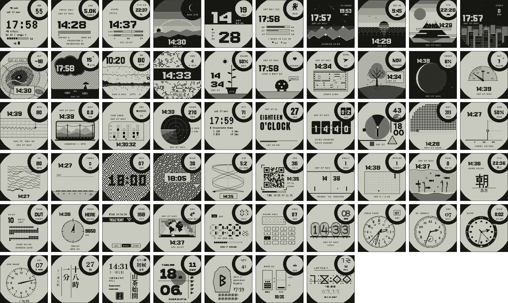

# Instinct Faces

[](https://github.com/getjump/instinct-faces/actions/workflows/ci.yml)
[](https://getjump.github.io/instinct-faces/)
[](LICENSE)

57 one-bit watch faces for the Garmin Instinct 3 Solar 45 mm, written in Monkey C, and a gallery that runs every original design live in the browser.

**[Open the gallery](https://getjump.github.io/instinct-faces/)**: live designs on a virtual clock (real time, x60, x600 or a fixed time), light and dark screens, four case colors, the design's own toggles (MRule's rule, demo data), and the frames the real build draws awake and asleep.

[](https://getjump.github.io/instinct-faces/)

## What is in it

- **Faces in 14 sets**: originals, dither studies, living things, sky and physics, geek, type and geometry, data as a picture, algorithms and math, toys, for the nomad, digital and analog classics, Japanese typography, scripts and glyphs. 43 of them move.
- **Built for the battery.** Asleep, a face draws one frame a minute. Seconds live in the sub-display circle through partial updates; animation runs only in the few seconds after a wrist raise. Asleep frames are designed to look finished, not frozen mid-step.
- **Real data where the watch has it**: heart rate, steps and step goal, battery, solar intensity, altitude, location, sunrise and sunset, moon phase. What cannot be real (a visa counter, an aquarium, a Pong score) is simulated and says so: see [Simulated data](#simulated-data).
- **Light and dark builds** of every face from one source.
- **A reproducible pipeline**: fonts from the design are rasterized at build time, art is baked from SVG, builds are byte-for-byte deterministic, and a simulator harness compares each face with its design.

<details>
<summary>All faces by set</summary>

| Set | Faces |
|---|---|
| Originals | Terminal, ConsumerLag, Nomad, Dither Sun, Brutal, Roguelike |
| Dither studies | Starry Night, Sea Sunset, Fuji, Night City, Topo, Rain, Ascent |
| Living things | Game of Life, Plant, Pet, Map Walk, Seasons |
| Sky and physics | Moon Phase, Sundial, Heart Seismograph, Train Window |
| Geek | Punch Card, Sonar, Traceroute |
| Type and geometry | Swiss, Split Flap, Bauhaus |
| Data as a picture | Year Dots, Solar Income, Ridgeline, Skyline |
| Algorithms and math | 10 Print Maze, Rule 30, Lissajous, QR Time |
| Toys | Pong, Snake, Aquarium |
| For the nomad | Japan, Visa, Home, Teletext, World |
| Digital classics, reimagined | LCD, Calc, Nixie |
| Analog classics, reimagined | Field, Rail, Diver, One Hand |
| Japanese typography | Vertical, Ko, Poster |
| Scripts and glyphs | Runes, Maya, Glyphs |

</details>

## Install

1. Download `<Name>.prg` from the [latest release](https://github.com/getjump/instinct-faces/releases/latest) (or from a face's page in the gallery), or [build it](#build-from-source).
2. Quit Garmin Express: it holds the device.
3. Connect the watch with a data cable. It is an MTP device: Windows and most Linux file managers open it directly; on macOS use an MTP client such as [OpenMTP](https://openmtp.ganeshrvel.com/).
4. Copy the `.prg` into `GARMIN/APPS/` and unplug.
5. Pick the face in the watch face list.

Copy only the faces you want: each takes storage and shows up in the list. Sideloaded faces have no settings page in Garmin Connect. To remove one, delete its file from `GARMIN/APPS/`.

## Simulated data

`fake` in `faces/<Name>/face.json` describes everything a face shows that is not real watch data. 15 faces have it; the gallery tags them.

## Build from source

Requirements:

- Python 3.10+ (the tools use the standard library only)
- [Connect IQ SDK](https://developer.garmin.com/connect-iq/sdk/) 9.x with the `instinct3solar45mm` device, installed by the SDK manager. Set `CIQ_HOME` if it lives somewhere other than the manager's default folder.
- Headless Chromium, to rasterize fonts and art: `npx playwright install chromium-headless-shell`, or point `CHROME_BIN` at a Chrome binary.
- `openssl`: the first build creates a local developer key in `.keys/`.

```bash
python3 tools/build.py Main          # one face -> dist/Main.prg
python3 tools/build.py --all         # every face
python3 tools/build.py --dark Main   # inverted variant
python3 tools/shot.py Main           # macOS: run in the simulator, write build/shots/Main.cmp.png
```

`build/shots/<Name>.cmp.png` shows the design, the face awake, awake 2.5 s later and asleep. `shot.py` also reports frame time, whether the animation moved and whether the face went to sleep.

## The gallery

`python3 tools/gallery.py` builds the site into `_site/` from `site/`, the designs, `refs/` and `previews/`; `python3 -m http.server -d _site` serves it. GitHub Pages runs the same command on every push to `main`. `--sheet docs/faces.png` also redraws the picture above.

Each card runs the original design (`design/<Name>.dc.html`) in a sandboxed `srcdoc` iframe without `allow-same-origin`. The page and the frames talk over `postMessage`; a shared virtual clock replaces `Date` inside the frames, so every face follows the clock controls. Frames mount only while visible. Design scripts come from this repository only: the gallery never loads third-party code into a frame.

The "Watch build" view shows `previews/<Name>.png`, the frames captured from the simulator, tinted for the chosen screen.

## Development

```bash
python3 tools/check.py                         # static checks: face.json schema, ASCII source, colors, assets, keys
uvx pytest                                     # unit tests
uvx ruff check . && uvx ruff format --check .  # Python lint and format
npm ci && npm run lint                         # eslint and prettier for site/
pre-commit install                             # all of the above on every commit
```

CI runs these checks, the MCP smoke test and a gallery build. It does not compile faces: the Connect IQ SDK requires a Garmin developer login and may not be redistributed, so releases are built locally.

Read [docs/PORTING.md](docs/PORTING.md) before porting a design or touching `core/`, and [CONTRIBUTING.md](CONTRIBUTING.md) before a pull request.

### Layout

| Path | What |
|---|---|
| `design/` | Original interactive designs: an SVG template with holes and a small JS component. Source of truth. |
| `refs/` | Each design rendered at 1 bit, the target for the port. |
| `faces/<Name>/` | The port: `face.json`, `source/View.mc`, `art/*.svg`. |
| `core/source/` | Shared Monkey C: the power-aware base view, time, drawing helpers, data sources. |
| `previews/` | Awake and asleep frames from the simulator. |
| `tools/` | Build, simulator harness, checks, gallery, MCP server. |
| `site/` | Gallery front end, vanilla JS, no build step. |

### Agents

[AGENTS.md](AGENTS.md) is the guide for coding agents. Skills in [`.agents/skills/`](.agents/skills) (linked from `.claude/skills`) cover porting a face, checking it in the simulator, installing it and cutting a release. [`.mcp.json`](.mcp.json) registers [`tools/mcp_server.py`](tools/mcp_server.py), run by `uv`, with seven tools: `list_faces`, `face_info`, `read_design`, `check_faces`, `build_face`, `shoot_face` (returns the comparison image) and `build_site`.

## Known limits

- Tested in the Connect IQ simulator only. CPU time, the watchdog, sensors and GPS have not been checked on a real watch, and the watch is much slower than the simulator. MRule and ARidge are the heaviest at about 30 ms per frame on a Mac.
- Built for `instinct3solar45mm`. Other Instinct models are untested.
- A physical bezel ring hides the main display out to about 44.5 px around the sub-display. Text was moved out of it; the top of KNixie's fourth tube and a corner of KCalc's display box still run under the ring.

## License

[MIT](LICENSE). Fonts are rasterized into the builds from Google Fonts under the SIL Open Font License, see [THIRD_PARTY_NOTICES.md](THIRD_PARTY_NOTICES.md).

Not affiliated with or endorsed by Garmin. Garmin, Instinct and Connect IQ are trademarks of Garmin Ltd. or its subsidiaries.
